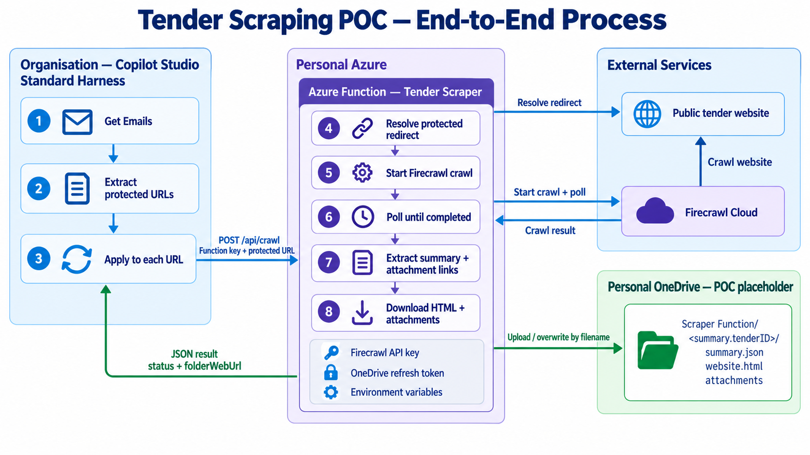

# Tender Scraper

A small Python web service (FastAPI, packaged as a Docker image) that turns a buy NSW tender email link into a saved tender package. One HTTP call:

1. resolves an Outlook Safe Link or buy NSW tracking link to the public opportunity page,
2. crawls it with [Firecrawl](https://firecrawl.dev) and waits for the crawl to finish,
3. extracts a structured tender summary and the attachment links,
4. downloads every attachment and saves `summary.json` and `website.html`,
5. optionally uploads the package to OneDrive, and
6. returns a compact JSON result suitable for Copilot Studio and Power Automate.

It is not tied to any cloud: the same image runs on a VPS, Azure (Container Apps, App Service, VM), AWS, GCP or a laptop. It is called from an organisation-owned Copilot Studio / Power Automate flow.



## Contents

- [Project layout](#project-layout)
- [Quick start](#quick-start)
- [Deploying](#deploying)
- [Configuration](#configuration)
- [API](#api)
- [Storage and filenames](#storage-and-filenames)
- [Optional OneDrive upload](#optional-onedrive-upload)
- [Power Automate and Copilot Studio](#power-automate-and-copilot-studio)
- [Testing](#testing)
- [Limitations and production direction](#limitations-and-production-direction)

## Project layout

| Path | Responsibility |
| --- | --- |
| `app.py` | FastAPI app: routes, API-key auth, request validation, synchronous polling, orchestration, response contract, error mapping. |
| `settings.py` | Shared environment-setting parsers. |
| `firecrawl_client.py` | URL validation, Safe Link / tracking-link resolution, Firecrawl payloads, API calls, result pagination. |
| `attachment_links.py` | Finds and deduplicates likely attachment URLs in Firecrawl documents. |
| `attachment_downloader.py` | Streams attachments into a traversal-safe job folder; returns size and SHA-256 per file. |
| `tender_artifacts.py` | Extraction schema, summary normalisation, primary-page selection, writes `summary.json` and `website.html`. |
| `onedrive_client.py` | Optional OneDrive upload: delegated token refresh, folder creation, replace-by-name via Microsoft Graph. |
| `scripts/get_onedrive_refresh_token.py` | One-time device-code login helper for OneDrive (local only). |
| `tests/` | pytest unit tests for every module (all network calls mocked). |
| `Dockerfile`, `docker-compose.yml`, `.env.example` | Container image and single-host deployment. |

Runtime dependencies: `fastapi`, `uvicorn`, `requests`.

## Quick start

### Docker (recommended)

```bash
cp .env.example .env        # set API_KEYS (e.g. openssl rand -hex 32) and FIRECRAWL_API_KEY
docker compose up -d --build
curl http://localhost:8080/healthz          # {"status":"ok"}
```

```bash
curl -X POST http://localhost:8080/api/crawl \
  -H "Content-Type: application/json" \
  -H "x-api-key: <API_KEY>" \
  -d '{"url":"https://buy.nsw.gov.au/prcOpportunity/...","limit":1}'
```

Interactive API docs are served at `/docs` (OpenAPI JSON at `/openapi.json`). Logs: `docker compose logs -f`. Stop: `docker compose down` (the data volume is kept).

### Without Docker

Requires Python 3.12 (3.10+ works).

```powershell
python -m venv .venv
.\.venv\Scripts\python.exe -m pip install -r requirements-dev.txt
Copy-Item .env.example .env      # set FIRECRAWL_API_KEY, API_KEYS (or API_AUTH_DISABLED=true), DOWNLOAD_DIR=downloads
.\.venv\Scripts\python.exe -m uvicorn app:app --env-file .env --reload --port 8000
```

## Deploying

The image listens on `PORT` (default `8000`), stores outputs under `/data`, exposes `GET /healthz` for health checks and runs as a non-root user. Anything that runs a container can host it.

### VPS with Docker Compose

1. Install Docker, copy the project (or `git clone`), create `.env` from `.env.example`.
2. `docker compose up -d --build`. `restart: unless-stopped` brings it back after reboots.
3. The port is published on `127.0.0.1` only, so put a TLS reverse proxy on the same host in front of it; the API key must not travel over plain HTTP. A minimal Caddy setup:

   ```text
   scraper.example.com {
       reverse_proxy localhost:8080
   }
   ```

   With nginx, forward the original host and scheme, and raise the read timeout because the POST stays open until the job finishes:

   ```nginx
   location / {
       proxy_pass http://127.0.0.1:8080;
       proxy_set_header Host $host;
       proxy_set_header X-Forwarded-Proto $scheme;
       proxy_set_header X-Forwarded-For $proxy_add_x_forwarded_for;
       proxy_read_timeout 300s;
   }
   ```

`statusUrl` and `next` are built from the request: the scheme comes from `X-Forwarded-Proto` (uvicorn `--proxy-headers`) and the host from the `Host` header the proxy forwards. Caddy forwards both by default; nginx needs `proxy_set_header Host $host`, otherwise the URLs show `127.0.0.1:8080`.

To expose the container directly without a proxy (for example on a private network), set `BIND_ADDRESS=0.0.0.0` in `.env`. Clients can then spoof `X-Forwarded-*` headers, which only affects logged client IPs and the scheme in `statusUrl`.

### Any container platform (Azure Container Apps, App Service, AWS, GCP, ...)

Build and push the image to a registry, then run it with the settings from [Configuration](#configuration) as environment variables (use the platform's secret store for `API_KEYS`, `FIRECRAWL_API_KEY` and `ONEDRIVE_REFRESH_TOKEN`).

```bash
docker build -t <registry>/tender-scraper:1.0 .
docker push <registry>/tender-scraper:1.0
```

- Target port: `8000` (or set `PORT`). Health probe: `GET /healthz`.
- Mount persistent storage at `/data` if you want local outputs to survive restarts; otherwise treat it as scratch and rely on the OneDrive upload.
- Check the platform's HTTP request timeout is longer than a job (for example, Azure Container Apps ingress allows up to 240 s; App Service allows 230 s).

Example, Azure Container Apps (builds from source and creates the registry for you):

```bash
az containerapp up --name tender-scraper --resource-group <RG> --location australiaeast \
  --source . --ingress external --target-port 8000 \
  --env-vars FIRECRAWL_API_KEY=secretref:... API_KEYS=secretref:...
```

## Configuration

All settings are environment variables (`.env` for Docker Compose and local runs). Never commit real values.

| Setting | Default | Description |
| --- | --- | --- |
| `API_KEYS` | — | **Required.** Comma-separated API keys accepted by the service. Requests without a valid key get `401`; if no keys are set every request fails with `500 CONFIGURATION_ERROR`. |
| `API_AUTH_DISABLED` | `false` | Set `true` to skip authentication (local development only). Boolean settings accept `true/false`, `1/0`, `yes/no`; anything else is a configuration error. |
| `FIRECRAWL_API_KEY` | — | Firecrawl bearer key. Required for Firecrawl Cloud; optional for an unauthenticated self-hosted server. |
| `FIRECRAWL_API_URL` | `https://api.firecrawl.dev` | Firecrawl base URL. `/v2` is appended unless it already ends in `/v1` or `/v2`. |
| `FIRECRAWL_REQUEST_TIMEOUT_SECONDS` | `30` (max 120) | Timeout for each Firecrawl API call. |
| `FIRECRAWL_POLL_INTERVAL_SECONDS` | `5` (max 60) | Delay between internal status checks. |
| `FIRECRAWL_POLL_TIMEOUT_SECONDS` | `240` (max 480) | How long the POST waits for the crawl. On timeout it returns `504` and skips downloads. **Keep it well under the caller's limit** — e.g. `75` for Power Automate's 120 s window. |
| `URL_RESOLUTION_TIMEOUT_SECONDS` | `20` (max 120) | Timeout for resolving Safe Links and tracking links. |
| `DEFAULT_CRAWL_LIMIT` | `1` | Page limit when a request omits `limit`. A tender and its attachments live on the starting page. |
| `MAX_CRAWL_LIMIT` | `1000` (max 10000) | Upper bound on `limit`, to cap accidental credit spend. |
| `DOWNLOAD_DIR` | `/data/downloads` in Docker, `downloads` otherwise | Local output root; relative paths resolve from the project folder. |
| `ATTACHMENT_DOWNLOAD_TIMEOUT_SECONDS` | `60` (max 600) | Timeout for each attachment GET. |
| `ONEDRIVE_ENABLED` | `false` | Upload outputs to OneDrive. |
| `ONEDRIVE_CLIENT_ID` | — | Public-client app registration ID (when enabled). |
| `ONEDRIVE_REFRESH_TOKEN` | — | Delegated personal-account refresh token (when enabled). Secret. |
| `ONEDRIVE_FOLDER` | `Scraper Function` | Root folder under the signed-in OneDrive. |
| `ONEDRIVE_REQUEST_TIMEOUT_SECONDS` | `120` (max 600) | Timeout for each identity / Graph call. |
| `LOG_LEVEL` | `INFO` | Python log level (`DEBUG`, `INFO`, `WARNING`, `ERROR`). Unknown values fall back to `INFO` with a warning. |
| `PORT` | `8000` | Port uvicorn listens on inside the container. |
| `BIND_ADDRESS` | `127.0.0.1` | Host address published by `docker-compose.yml`; `0.0.0.0` exposes the port on all interfaces. |
| `HOST_PORT` | `8080` | Host port published by `docker-compose.yml`. |

## API

### Authentication

`/api/*` routes require one of the `API_KEYS`, sent as:

- `x-api-key: <key>` header (preferred), or
- `x-functions-key: <key>` header, or `?code=<key>` query parameter — accepted so callers written for the earlier Azure Functions version keep working unchanged. `code=` values are redacted from access logs, but prefer a header.

`GET /healthz`, `/docs` and `/openapi.json` are public.

### `POST /api/crawl`

Starts the crawl, polls until it finishes, processes outputs, uploads, and only then responds.

```json
{
  "url": "https://apc01.safelinks.protection.outlook.com/?url=...",
  "limit": 1
}
```

`url` may be a direct page, an Outlook Safe Link or a `connect.buy.nsw.gov.au` tracking URL. The service always asks Firecrawl for links, raw HTML and structured JSON, with caching off (`maxAge: 0`) because buy NSW attachment links are pre-signed URLs that expire after an hour. Extra caller-supplied Firecrawl options are kept. Raise `limit` only when the data genuinely spans several pages, because extraction runs (and is billed) on every page.

Abridged completed response:

```json
{
  "success": true,
  "status": "completed",
  "terminal": true,
  "jobId": "01ab2345-cdef-6789-abcd-ef0123456789",
  "statusUrl": "https://scraper.example.com/api/crawl/01ab2345-cdef-6789-abcd-ef0123456789",
  "inputUrl": "https://apc01.safelinks.protection.outlook.com/?url=...",
  "resolvedUrl": "https://buy.nsw.gov.au/prcOpportunity/...",
  "summary": {
    "name": "RFI - Enterprise Service Management (Service Desk) Solution",
    "agency": "NSW State Emergency Service",
    "tenderID": "NSWSES001090 - Request For Information",
    "category": "Information and technology",
    "closeDate": "09-Oct-2026 3:00 PM",
    "locations": "All regions",
    "type": "RFI (Open)",
    "description": "...",
    "contact": "...",
    "url": "https://buy.nsw.gov.au/prcOpportunity/..."
  },
  "attachmentCount": 2,
  "attachmentLinks": ["https://.../rfq-addenda-001.docx", "https://.../terms.pdf"],
  "downloads": {
    "status": "completed", "total": 2, "downloaded": 2, "existing": 0, "failed": 0,
    "files": [
      {"status": "downloaded", "fileName": "rfq-addenda-001.docx", "sizeBytes": 57059, "sha256": "..."}
    ]
  },
  "artifacts": {
    "status": "completed",
    "summary": {"status": "saved", "fileName": "summary.json"},
    "html": {"status": "saved", "fileName": "website.html"}
  },
  "oneDrive": {
    "status": "completed",
    "folderName": "NSWSES001090 - Request For Information",
    "folderWebUrl": "https://onedrive.live.com/...",
    "total": 4, "uploaded": 4, "failed": 0,
    "files": [{"status": "uploaded", "fileName": "summary.json", "webUrl": "https://onedrive.live.com/..."}]
  },
  "polling": {"attempts": 3, "elapsedSeconds": 11.4},
  "message": "Crawl completed and outputs were processed."
}
```

Summary fields are always present; missing values are empty strings. `summary.url` is always the resolved public URL, never a Safe Link.

**Success check.** HTTP `200` alone is not success — the crawl can complete while downloads or uploads fail. Require `status == "completed"`, plus `downloads.status == "completed"`, plus `oneDrive.status == "completed"` when OneDrive is enabled (it is `disabled` otherwise).

**Errors** share the shape `{"success": false, "status": "error", "errorCode": "...", "error": "...", "retryable": bool}`:

| HTTP | `errorCode` | Meaning |
| --- | --- | --- |
| 400 | `INVALID_REQUEST` | Bad body, URL or parameter. |
| 401 | `UNAUTHORIZED` | Missing or invalid API key. |
| 4xx | `FIRECRAWL_ERROR` | Firecrawl rejected the request; `429` carries `Retry-After`. |
| 500 | `CONFIGURATION_ERROR` | A setting is missing or invalid (including no `API_KEYS`). |
| 502 | `FIRECRAWL_ERROR` / `FIRECRAWL_UNAVAILABLE` | Firecrawl server error or unreachable. |
| 502 | `URL_RESOLUTION_ERROR` | The protected / tracking link could not be resolved. |
| 504 | `CRAWL_POLL_TIMEOUT` | Crawl not finished within `FIRECRAWL_POLL_TIMEOUT_SECONDS`; no downloads started. Includes `jobId`. |
| 500 | `INTERNAL_ERROR` | Unexpected failure (details only in logs). |

### `GET /api/crawl/{jobId}`

Diagnostics and recovery; normal callers do not need it. Returns the job status and, once completed, processes outputs like the POST (attachment links in an old job may have expired). Optional query parameters: `skip` and `pageLimit` (Firecrawl result pagination) and `includeData=true` (raw Firecrawl documents — can be several MB, so never use it from Copilot Studio, which rejects responses over 500 KB).

### `GET /healthz`

Returns `{"status": "ok"}`. Used by the Docker `HEALTHCHECK` and platform probes.

## Storage and filenames

Each job writes to:

```text
<DOWNLOAD_DIR>/<Firecrawl job ID>/
├── summary.json
├── website.html
└── <attachments>
```

In Docker this is the `scraper-data` volume mounted at `/data`, so outputs survive container restarts and upgrades. Folders accumulate per job; prune old ones if disk space matters.

When OneDrive is enabled, the package is also uploaded to:

```text
OneDrive/<ONEDRIVE_FOLDER>/<summary.tenderID>/
```

- The folder name is the extracted `tenderID` (invalid characters become hyphens), falling back to `summary.name`, then the job ID.
- **Attachments keep their original filenames**, so each re-scrape overwrites the previous OneDrive copy and only the latest version is kept. buy NSW issues a different download URL on every visit, so names are not derived from URLs. A short URL hash is appended only when two different attachments in the same crawl share a filename.
- Use the per-file `sha256` to tell whether a document's content actually changed.
- Uploads use Graph simple upload: **250 MB per file** maximum.

## Optional OneDrive upload

The current POC destination is a personal OneDrive, using delegated Graph access (`Files.ReadWrite`, `offline_access`, `consumers` authority). It is off by default; the service works fully without a Microsoft account.

1. In Microsoft Entra admin center create an **App registration** for personal Microsoft accounts.
2. Under **Authentication**, enable **Allow public client flows**.
3. Under **API permissions**, add delegated Microsoft Graph **Files.ReadWrite**.
4. Run the login helper with the Application (client) ID:

   ```powershell
   .\.venv\Scripts\python.exe scripts\get_onedrive_refresh_token.py <CLIENT_ID>
   ```

5. Complete the device login with the target account and copy the refresh token. Do not share or commit it.
6. Set `ONEDRIVE_ENABLED=true`, `ONEDRIVE_CLIENT_ID` and `ONEDRIVE_REFRESH_TOKEN` in `.env`, then `docker compose up -d`.

## Power Automate and Copilot Studio

### Flow structure

```text
Get emails
└── Apply to each email                      (body.value)
    ├── Find tender anchors                  (Compose)
    └── Apply to each anchor                 outputs('Find_tender_anchors')
        ├── Extract protected URL            (Compose)
        ├── Scrape tender                    (HTTP)
        └── Check crawl and OneDrive status  (Condition)
```

Enter every formula through the **fx / Function** editor. If a Compose output literally contains `skip(...)` or `replace(...)`, it was typed as text and is not being evaluated.

**Find tender anchors**

```text
skip(split(item()?['body'], 'class="btn-cm link-btn-cm"'), 1)
```

**Extract protected URL** — `concat('&', 'amp;')` stops the designer converting the entity while editing:

```text
replace(
  first(split(first(skip(split(item(), 'href="'), 1)), '"')),
  concat('&', 'amp;'),
  '&'
)
```

Do not wrap the extracted URL in another Apply to each; it is a single string.

**Scrape tender** (HTTP action)

```text
Method:         POST
URI:            https://<your-host>/api/crawl
Authentication: None
Headers:        Content-Type: application/json
                x-api-key: <API_KEY>          (x-functions-key also works)
Body:           {"url": "@{outputs('Extract_protected_URL')}", "limit": 1}
```

- Enable **Secure Inputs** so the key is hidden in run history.
- Disable automatic retry — a retry starts another Firecrawl crawl and spends credits.

**Check crawl and OneDrive status**

```text
and(
  equals(body('Scrape_tender')?['status'], 'completed'),
  equals(body('Scrape_tender')?['oneDrive']?['status'], 'completed')
)
```

### Copilot Studio

The Standard Harness **Send HTTP request** node works without a custom connector or Power Automate Premium. Use the same URL, headers and body; set **Continue on error**, capture the status code and body, and branch on both the HTTP status and `success`. Generate the response type from the completed response above, or import `/openapi.json` when building a custom connector.

### Timeouts

Power Automate synchronous HTTP calls time out after **120 seconds**. Polling, downloads and uploads must all fit inside that window, so set `FIRECRAWL_POLL_TIMEOUT_SECONDS` to about `75`. Slow crawls will then return `504` rather than hang. Any reverse proxy or platform ingress in between must allow at least as long.

## Testing

```powershell
.\.venv\Scripts\python.exe -m pytest -q
```

Tests mock all network calls; nothing contacts Firecrawl, OneDrive or buy NSW. HTTP routes are tested through FastAPI's `TestClient`.

## Limitations and production direction

- The email parser depends on the exact `btn-cm link-btn-cm` class; a buy NSW template change breaks extraction.
- The whole job runs inside one synchronous HTTP request bounded by the caller's timeout.
- Personal OneDrive with a refresh token is a placeholder identity model, not suitable for production.

Preferred production direction:

```text
Tender Scraper
    └── Durable object storage (system of record: S3-compatible, Azure Blob, ...)
            └── Queue / event
                    └── Asynchronous publisher (e.g. SharePoint with organisation app auth)
```

This decouples scraping from the publishing target, removes the long-held HTTP request, and enables retries and lifecycle management.

## References

- [FastAPI deployment concepts](https://fastapi.tiangolo.com/deployment/concepts/)
- [Uvicorn settings (proxy headers)](https://www.uvicorn.org/settings/)
- [Firecrawl v2 crawl endpoint](https://docs.firecrawl.dev/api-reference/endpoint/crawl-post)
- [Copilot Studio: Make HTTP requests](https://learn.microsoft.com/microsoft-copilot-studio/authoring-http-node)
- [Copilot Studio: connector responses must stay below 500 KB](https://learn.microsoft.com/troubleshoot/power-platform/copilot-studio/actions/connector-request-failure)
- [Azure Container Apps: `az containerapp up`](https://learn.microsoft.com/azure/container-apps/containerapp-up)
- [Microsoft identity device authorization grant](https://learn.microsoft.com/entra/identity-platform/v2-oauth2-device-code)
- [Upload small files to OneDrive](https://learn.microsoft.com/graph/api/driveitem-put-content)
